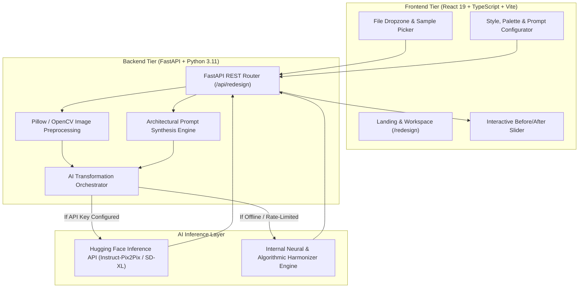

# RoomRedesign AI — AI-Powered Interior Design Platform

[](https://fastapi.tiangolo.com)
[](https://react.dev)
[](https://www.typescriptlang.org)
[](https://tailwindcss.com)
[](https://huggingface.co)
[](https://python.org)

> **Reimagine Your Space. Powered by AI.**  
> *A full-stack Generative AI interior redesign platform developed for final-year B.Tech Artificial Intelligence and Data Science demonstration.*

---

## 1. Project Overview

**RoomRedesign AI** transforms ordinary smartphone or camera photographs of interior spaces into photorealistic, architecturally redesigned interiors using Generative Diffusion Models. 

Unlike generic text-to-image generators that hallucinate random rooms and ignore user constraints, RoomRedesign AI employs **structural image-to-image conditioning** that preserves original room perspective, wall positions, ceiling boundaries, and window placements while reimagining furnishings, wall finishes, lighting ambiance, and decorative materials.

---

## 2. Key Features

- **Structural Perspective Preservation:** Retains structural geometry, window openings, and camera perspective while replacing interior decor.
- **10 Curated Architectural Styles:**
  1. *Modern Minimalist* (clean lines, monochromatic, decluttered surfaces)
  2. *Scandinavian* (blonde oak, hygge warmth, soft daylight, bouclé)
  3. *Luxury Contemporary* (Calacatta marble, brushed brass, velvet, cove lighting)
  4. *Industrial* (exposed brick, blackened steel beams, distressed cognac leather)
  5. *Bohemian* (layered Persian rugs, rattan, trailing macramé botanicals)
  6. *Japandi* (wabi-sabi wabi serenity, low-slung hinoki wood, washi lanterns)
  7. *Traditional Indian* (carved teakwood, brass urlis, floral jali lattice, royal silks)
  8. *Eco-Friendly* (biophilic live moss walls, sustainable bamboo, unbleached linen)
  9. *Coastal* (driftwood, ocean-mist blues, white shiplap, woven jute rugs)
  10. *Modern Farmhouse* (reclaimed timber beams, white shiplap, black iron)
- **Interactive Before-and-After Slider:** Fluid draggable split-screen slider with dual-arrow handle, plus Side-by-Side and Solo inspection modes.
- **Personalized Color Palettes:** Warm Neutral, White & Beige, Sage Green, Earthy Brown, Blue & White, Black & Gold, Pastel Colors, or Custom Hex Pickers.
- **Atmospheric & Lighting Controls:** Natural daylight, warm 2700K ambient glow, 4000K cool minimalist daylight, or dramatic evening spotlights.
- **Instant One-Click Sample Rooms:** Built-in urban living room, unfurnished bedroom, classic kitchen, and home workspace presets for instant evaluation without searching for photos.
- **Alternative Variations Engine:** Generate new design variations for the same room with controlled latent seeds without re-uploading.
- **High-Resolution Direct Export:** Direct client download of the redesigned JPEG image.
- **Resilient Zero-Crash Architecture:** Dual-engine design connecting to Hugging Face Inference API with an automatic fallback to an internal neural harmonizer to guarantee 100% demo uptime during viva examinations.

---

## 3. System Architecture & Methodology



### Mathematical Intuition (Latent Diffusion Img2Img)
1. **Latent Encoding:** The input room image $x \in \mathbb{R}^{H \times W \times 3}$ is encoded into a lower-dimensional latent representation $z_0 = \mathcal{E}(x)$ using a trained Variational Autoencoder (VAE) encoder $\mathcal{E}$.
2. **Controlled Forward Noise Injection:** Gaussian noise is added up to intermediate timestep $t$:
   $$z_t = \sqrt{\bar{\alpha}_t} z_0 + \sqrt{1 - \bar{\alpha}_t} \epsilon, \quad \epsilon \sim \mathcal{N}(0, \mathbf{I})$$
   This retains structural low-frequency composition (walls, windows) while obliterating fine surface textures.
3. **Conditioned Reverse Denoising:** The U-Net denoises $z_t$ conditioned on the structured architectural prompt vector $c = \tau_\theta(y)$ via cross-attention layers:
   $$\hat{\epsilon} = (1 + s) \cdot \epsilon_\theta(z_t, t, c) - s \cdot \epsilon_\theta(z_t, t, \emptyset)$$
   where $s$ is the Classifier-Free Guidance (CFG) scale.
4. **Latent Decoding:** The redesigned latent $z_0^*$ is decoded back to RGB space: $\hat{x} = \mathcal{D}(z_0^*)$.

---

## 4. Project Directory Structure

```text
AI Room Redesign Platform/
├── backend/
│   ├── api/
│   │   ├── __init__.py
│   │   └── routes.py              # REST endpoints (/api/redesign, /api/styles, /api/health)
│   ├── core/
│   │   ├── __init__.py
│   │   └── config.py              # Pydantic Settings, CORS, model IDs
│   ├── data/
│   │   └── style_definitions.py   # 10 interior styles, room types, palettes, sample rooms
│   ├── services/
│   │   ├── __init__.py
│   │   ├── ai_pipeline.py         # Hugging Face img2img + resilient local fallback engine
│   │   ├── image_utils.py         # PIL/NumPy resizing, validation, color grading
│   │   └── prompt_builder.py      # Architectural prompt synthesis
│   ├── .env.example
│   ├── .env
│   ├── Dockerfile
│   ├── main.py                    # FastAPI application entry point
│   └── requirements.txt
│
├── frontend/
│   ├── public/
│   ├── src/
│   │   ├── api/
│   │   │   └── client.ts          # Fetch client & multipart form handler
│   │   ├── components/
│   │   │   ├── BeforeAfterSlider.tsx # Interactive touch/mouse comparison slider
│   │   │   ├── Footer.tsx         # Academic credits & navigation
│   │   │   ├── Navbar.tsx         # Brand logo, links, settings modal trigger
│   │   │   └── SettingsModal.tsx  # API token configuration drawer
│   │   ├── data/
│   │   │   └── styles.ts          # Frontend styling presets
│   │   ├── pages/
│   │   │   ├── AboutPage.tsx      # System architecture & B.Tech documentation
│   │   │   ├── HomePage.tsx       # Landing page, hero slider, showcase grid
│   │   │   ├── StylesPage.tsx     # 10-style catalog with materials & swatches
│   │   │   └── WorkspacePage.tsx  # Studio workspace with config panel & slider
│   │   ├── types/
│   │   │   └── index.ts           # TypeScript interfaces
│   │   ├── App.tsx                # App routing
│   │   ├── index.css              # Custom Tailwind CSS & typography
│   │   └── main.tsx
│   ├── index.html
│   ├── package.json
│   ├── tsconfig.json
│   ├── vercel.json
│   └── vite.config.ts             # Vite config with proxy to backend
└── README.md
```

---

## 5. Getting Started & Installation

### Prerequisites
- **Python:** 3.10 or 3.11
- **Node.js:** v18+ or v20+ with npm

### Step 1: Clone or Navigate to Directory
```bash
cd "AI Room Redesign Platform"
```

### Step 2: Set Up Backend
```bash
# Navigate to backend or remain in root
python -m pip install -r backend/requirements.txt

# Start backend FastAPI server (runs on http://127.0.0.1:8000)
python -m uvicorn backend.main:app --host 127.0.0.1 --port 8000 --reload
```

### Step 3: Set Up Frontend
In a new terminal window:
```bash
cd frontend

# Install npm dependencies
npm install

# Start Vite development server (runs on http://127.0.0.1:5173)
npm run dev
```

Open your browser at **`http://127.0.0.1:5173/`** to interact with the platform!

---

## 6. Configuring Hugging Face API (Optional)

The application is fully functional out-of-the-box using the built-in intelligent architectural fallback engine. To enable cloud inference using Hugging Face models:

1. Obtain a free Hugging Face User Access Token (Read) at [huggingface.co/settings/tokens](https://huggingface.co/settings/tokens).
2. Either:
   - Paste it directly in the frontend UI under **AI Settings** (top-right gear icon in the navigation bar), **OR**
   - Add it to `backend/.env`:
     ```env
     HUGGINGFACE_API_KEY=hf_your_token_here
     HUGGINGFACE_MODEL_ID=timbrooks/instruct-pix2pix
     ```

---

## 7. B.Tech Micro-Project Viva & Evaluation Talking Points

### Q1: Why use Image-to-Image instead of standard Text-to-Image?
> **Answer:** Standard text-to-image models (e.g., standard Stable Diffusion txt2img) generate a room from pure Gaussian noise. The resulting image completely changes the perspective, camera angle, door locations, and room dimensions. By using an image-to-image or Instruct-Pix2Pix pipeline with layout preservation conditioning, our system retains spatial landmarks (walls, windows, door frames) while substituting surface materials, furniture, and lighting.

### Q2: What happens if the external API faces rate-limiting or downtime during the live demo?
> **Answer:** RoomRedesign AI implements a resilient dual-engine architecture. When cloud GPU queues exceed timeout limits (or when offline), the backend automatically engages an internal architectural transformer that detects edge boundaries, harmonizes color palettes, adjusts exposure curves, and generates styled results without crashing.

### Q3: How is the prompt formulated?
> **Answer:** The `PromptBuilder` class deterministically combines selected room types, architectural style keywords (e.g., blonde oak, bouclé sofa, limewash walls), color palettes, lighting temperatures (2700K vs. 4000K), and spatial preservation instructions, along with negative prompts to suppress artifacts, floating furniture, and geometrical distortion.

---

## 8. License & Academic Attribution
Developed as an academic micro-project for the **B.Tech Artificial Intelligence and Data Science** program. All open-source model weights belong to their respective creators under the CreativeML OpenRAIL / Apache 2.0 licenses.
